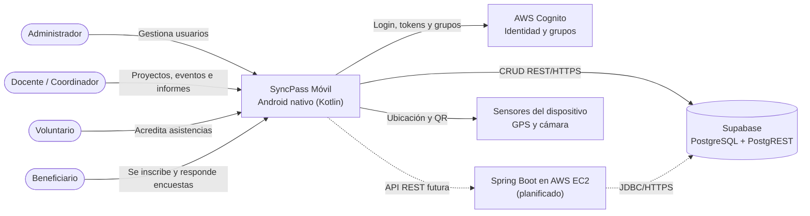
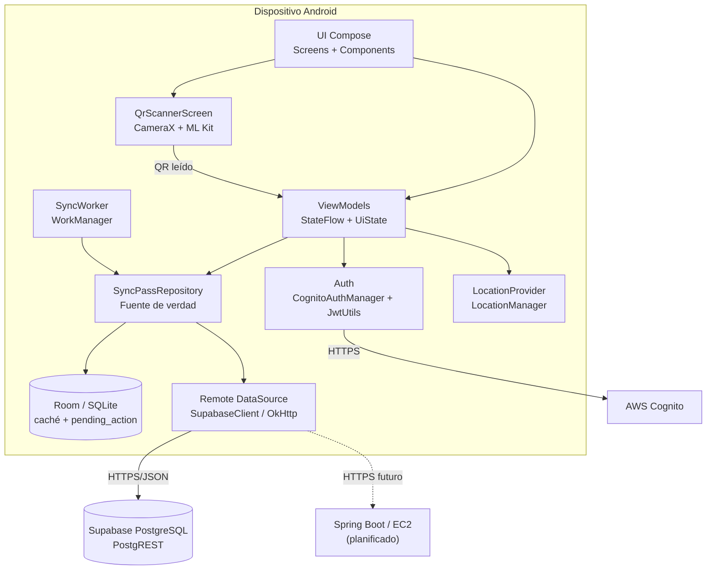
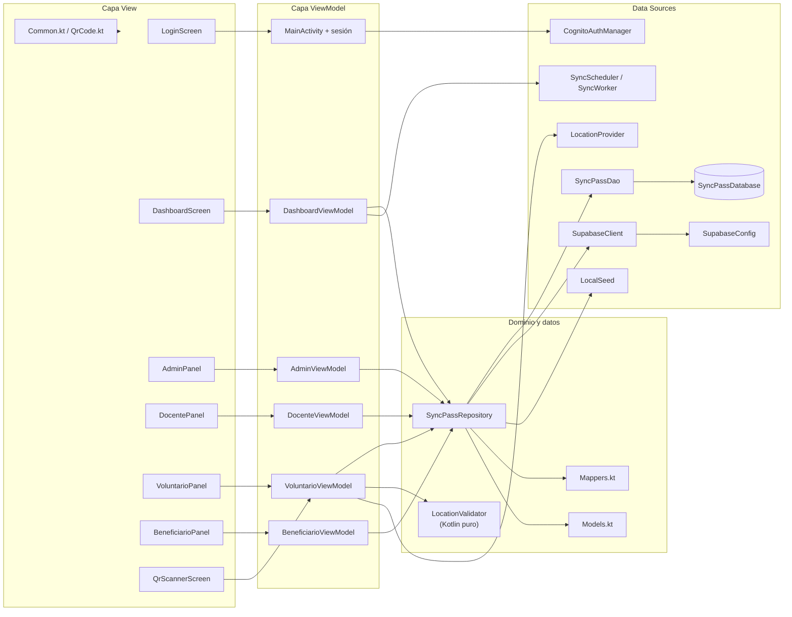
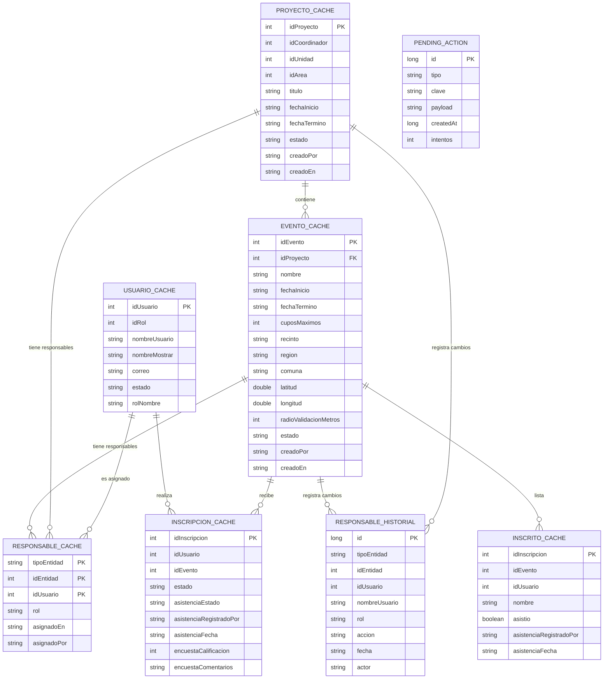
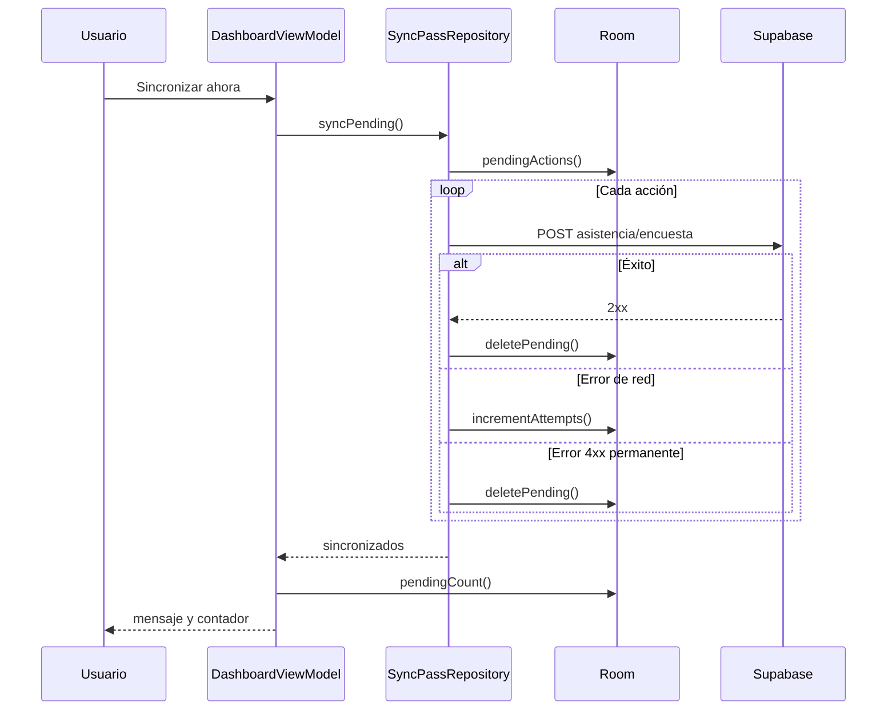
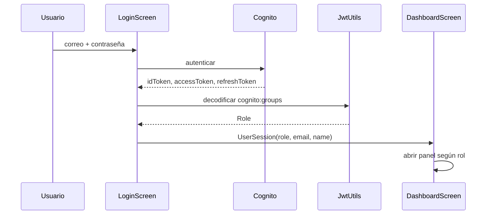
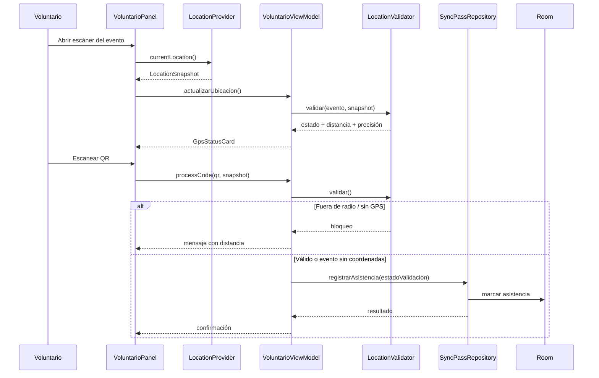

# Arquitectura del sistema

## 1. Principios

1. **MVVM estricto:** la UI no conoce Room, HTTP ni GPS; solo observa estado y emite eventos.
2. **Repository como única fuente de verdad:** decide entre remoto, caché y almacenamiento local.
3. **Offline-first:** toda operación crítica debe completarse sin red y sincronizarse después.
4. **Dominio testeable:** reglas de negocio puras (GPS, métricas, mapeos) separadas de Android.
5. **Degradación controlada:** si Supabase/EC2 no responde, la app sigue operando con datos locales.
6. **Trazabilidad:** cada asistencia registra inscripción, fecha, coordenadas y estado de validación.

---

## 2. C4 — Nivel 1: Contexto



**Lectura del contexto**

- La app es el punto de interacción de los cuatro roles.
- Cognito es la autoridad de identidad; la app solo consume tokens y grupos.
- Supabase es el backend remoto actual del MVP.
- Spring Boot/EC2 es el contenedor exigido por la rúbrica; está planificado y la app ya tiene la capa de red preparada para incorporarlo.
- GPS y cámara son APIs nativas del dispositivo, no servicios externos.

---

## 3. C4 — Nivel 2: Contenedores



### 3.1 Responsabilidades por contenedor

| Contenedor | Responsabilidad | Tecnología |
| --- | --- | --- |
| UI Compose | Renderizar estado y capturar eventos del usuario. | Jetpack Compose, Material 3. |
| ViewModels | Orquestar casos de uso, validar y exponer `StateFlow`. | Kotlin, coroutines. |
| SyncPassRepository | Única puerta de acceso a datos; remoto con fallback local. | Kotlin singleton. |
| Room | Caché offline, seed y cola de pendientes. | Room 2.8.5. |
| Remote DataSource | Operaciones REST contra Supabase/PostgREST. | OkHttp + Gson. |
| Auth | Login Cognito, decodificación JWT y sesión. | AWS SDK 2.77.0. |
| LocationProvider | Lectura GPS con precisión y antigüedad. | `LocationManager`. |
| QrScannerScreen | Vista de cámara y decodificación QR. | CameraX + ML Kit. |
| SyncWorker | Reintento de sincronización en background. | WorkManager. |

### 3.2 Flujo de datos resumido

```text
Usuario → Compose → ViewModel → Repository ─┬→ Room (siempre)
                                            └→ Supabase (si hay red/config)
                                       ↓
                              StateFlow → Compose
```

El repositorio escribe primero en Room cuando la operación es local o cuando el remoto falla. Si hay remoto, intenta la operación y actualiza la caché. Las operaciones diferidas se guardan en `pending_action`.

---

## 4. C4 — Nivel 3: Componentes de la app



### 4.1 Componentes clave

| Componente | Rol | Depende de |
| --- | --- | --- |
| `MainActivity` | Decide login vs. dashboard y restaura sesión. | Cognito, JwtUtils, DemoAuth. |
| `DashboardScreen` | Contenedor por rol, aviso local y sincronización manual. | DashboardViewModel. |
| `AdminViewModel` | CRUD de usuarios y roles. | SyncPassRepository. |
| `DocenteViewModel` | Proyectos, eventos, QR e informes. | SyncPassRepository. |
| `VoluntarioViewModel` | Escaneo, validación GPS y acreditación. | Repository, LocationValidator. |
| `BeneficiarioViewModel` | Inscripciones, QR y encuestas. | SyncPassRepository. |
| `SyncPassRepository` | Orquesta remoto/local, caché y cola. | Room, SupabaseClient, Gson. |
| `LocationValidator` | Calcula Haversine y decide el estado. | Kotlin stdlib. |
| `LocalSeed` | Datos ficticios iniciales. | SyncPassDao. |
| `SyncWorker` | Reintenta pendientes. | Repository, WorkManager. |

### 4.2 Regla de dependencia

```text
View → ViewModel → Repository → DataSource
```

Nunca al revés. Las pantallas no importan `SyncPassDao`, `SupabaseClient` ni `LocationProvider`; el escáner solo entrega el texto del QR al ViewModel.

---

## 5. Estructura de paquetes

```text
cl.kcorp.syncpass
├── MainActivity.kt
├── data
│   ├── auth          CognitoAuthManager, JwtUtils, DemoAuth
│   ├── local         Entities, SyncPassDao, SyncPassDatabase, LocalSeed, Mappers
│   ├── location      LocationProvider, LocationValidator
│   ├── model         Models (Usuario, Proyecto, Evento, Inscripcion, etc.)
│   ├── remote        SupabaseClient, SupabaseConfig
│   ├── repository    SyncPassRepository
│   └── sync          SyncScheduler, SyncWorker
└── ui
    ├── components    Common, QrCode
    ├── dashboard     DashboardScreen, DashboardViewModel
    ├── login         LoginScreen
    ├── panels        Admin, Docente, Voluntario, Beneficiario + ViewModels
    ├── scanner       QrScannerScreen
    └── theme         Color, Type, Theme
```

---

## 6. Modelo de datos

### 6.1 Entidades locales (Room)



### 6.2 Tablas remotas esperadas (Supabase/PostgreSQL)

| Tabla | Campos principales |
| --- | --- |
| `rol` | `id_rol`, `nombre`, `descripcion` |
| `usuario` | `id_usuario`, `id_rol`, `nombre_usuario`, `nombre_mostrar`, `correo`, `estado` |
| `proyecto` | `id_proyecto`, `id_coordinador`, `titulo`, `fecha_inicio`, `fecha_termino`, `estado`, `creado_por`, `creado_en` |
| `proyecto_docente` | Reemplazada localmente por `responsable_cache`; el esquema remoto aún no tiene responsables ni historial. |
| `evento` | `id_evento`, `id_proyecto`, `nombre`, `fecha_inicio`, `fecha_termino`, `cupos_maximos`, `region`, `comuna`, `latitud`, `longitud`, `radio_validacion_metros`, `creado_por`, `creado_en` |
| `inscripcion` | `id_inscripcion`, `id_usuario`, `id_evento`, `estado`, `fecha_inscripcion` |
| `asistencia` | `id_asistencia`, `id_inscripcion`, `fecha_marcacion`, `latitud`, `longitud`, `estado_validacion`, `identificador_operacion`, `registrado_por` |
| `encuesta` | `id_inscripcion`, `calificacion`, `utilidad`, `comentarios` |

> Las columnas de auditoría se escriben de forma *best-effort*: si el esquema remoto aún no
> las tiene, `retryWithoutUnknownColumns` retira la columna y la operación continúa.
> Los responsables (`responsable_cache`) y su historial (`responsable_historial`) son
> **solo locales** por ahora; no se envían a Supabase.

### 6.3 Estados

| Entidad | Estados |
| --- | --- |
| Proyecto | `PLANIFICADO`, `EN_CURSO`, `FINALIZADO` |
| Evento | `PROGRAMADO`, `EN_CURSO`, `FINALIZADO`, `CANCELADO` |
| Inscripción | `INSCRITO`, `CANCELADO` |
| Asistencia | `VALIDADA`, `SIN_VALIDACION` |
| Sync | `PENDIENTE`, `SINCRONIZADO` |

### 6.4 Validación de fechas y auditoría

| Regla | Implementación |
| --- | --- |
| Término ≥ inicio | `FechaValidator` valida proyectos (`yyyy-MM-dd`) y eventos (`yyyy-MM-ddTHH:mm`); el mismo día/hora es válido. |
| Evento dentro del proyecto | `FechaValidator.rangoDentroDePeriodo` exige que el evento empiece en/después del inicio del proyecto y termine en/antes de su término. El último día se admite completo. |
| Selectores | `DateField` y `DateTimeField` (Material 3) evitan el ingreso manual de fechas y horas. |
| Docentes y voluntarios a cargo | Tabla `responsable_cache` con rol. El evento puede tener su propio equipo independiente del proyecto. |
| Auditoría | `creadoPor`/`creadoEn` en proyectos y eventos; `asistenciaRegistradoPor`/`asistenciaFecha` en la asistencia. |
| Ubicación del evento | Región y comuna se eligen desde `UbicacionesChile` con listas dependientes; no se escriben a mano. |
| Radio de validación | Catálogo cerrado `20`, `40`, `60`, `80`, `100` m; `normalizarRadio` ajusta valores antiguos al más cercano. |
| Coordenadas GPS | Son opcionales. El alta/edición no las pide; los eventos existentes las conservan y la validación sigue activa. |

### 6.5 Responsables e historial

| Regla | Implementación |
| --- | --- |
| Responsables múltiples | `responsable_cache` guarda `tipoEntidad`, `idEntidad`, `idUsuario` y `rol` (`DOCENTE` o `VOLUNTARIO`). |
| Proyectos | Docentes y voluntarios a cargo; la UI usa `DocentesMultiSelect` con distinto label. |
| Eventos | Lista propia de responsables, independiente del proyecto. |
| Cambios | `calcularCambiosResponsables` compara el conjunto actual con el nuevo y devuelve altas y bajas. |
| Historial | `responsable_historial` registra acción `AGREGADO`/`ELIMINADO`, persona, rol, fecha y actor. |
| Eliminación | Al borrar un usuario se retiran sus asignaciones actuales; el historial conserva el nombre registrado. |

> **Fase actual: pruebas locales.** Supabase está offline; por ahora se validan el CRUD,
> los responsables y el historial contra Room. Cuando el modelo de Supabase esté disponible,
> se agregarán las tablas remotas y la sincronización correspondiente. Esto se mantiene
> como deuda técnica documentada y no bloquea la demo.

La base Room sube a **versión 5**; `fallbackToDestructiveMigration` reconstruye la
caché y el seed vuelve a sembrar los datos demo.

---

## 7. Validación GPS

### 7.1 Objetivo

Confirmar que el asistente está **en el lugar o cerca del lugar** del evento antes de acreditar su asistencia.

### 7.2 Componentes

| Componente | Responsabilidad |
| --- | --- |
| `LocationProvider` | Obtener latitud, longitud, precisión y antigüedad desde `LocationManager`. |
| `LocationSnapshot` | DTO inmutable de la lectura GPS. |
| `LocationValidator` | Lógica pura de distancia y decisión. |
| `UbicacionEventoDialog` | Fija o quita el punto de referencia del evento (ubicación actual o enlace). |
| `CoordenadasParser` / `UbicacionEventoValidator` | Interpreta enlaces y pares de coordenadas; advierte sobre precisión y radio. |
| `VoluntarioViewModel` | Orquesta lectura, validación, bloqueo y registro. |
| `GpsStatusCard` | Muestra estado, distancia y precisión antes de escanear. |

El **punto de referencia** se configura después de crear el evento, desde su tarjeta. El alta no exige coordenadas y el docente no necesita conocerlas: puede leer la ubicación actual estando en el recinto o pegar un enlace de Google Maps. La configuración se guarda primero en Room y luego se envía a Supabase cuando está disponible.

### 7.3 Distancia Haversine

La distancia se calcula sobre la esfera terrestre:

```text
Δφ = φ₂ − φ₁
Δλ = λ₂ − λ₁
a = sin²(Δφ/2) + cos(φ₁)·cos(φ₂)·sin²(Δλ/2)
c = 2·asin(min(1, √a))
d = R·c        con R = 6.371.000 m
```

Ventajas:

- No requiere Google Play Services.
- Es suficientemente precisa para los radios permitidos de 20 a 100 m.
- Es determinista y testeable sin emulador.

### 7.4 Regla de decisión

```text
radio = normalizarRadio(radioValidacionMetros > 0 ? radioValidacionMetros : 100)
        // valores permitidos: 20, 40, 60, 80, 100
si evento sin coordenadas → EVENTO_SIN_COORDENADAS (permite, SIN_VALIDACION)
si no hay lectura GPS → SIN_UBICACION (bloquea)
si precisión > 250 m → PRECISION_INSUFICIENTE (bloquea)
tolerancia = min(precisión, min(75 m, radio/2))
distanciaEfectiva = max(0, distancia − tolerancia)
si distanciaEfectiva ≤ radio → VALIDADA
si no → FUERA_DE_RADIO (bloquea)
```

### 7.5 Por qué no comparar solo `distancia ≤ radio`

Un GPS urbano puede informar ±30 m. Si el asistente está a 110 m de un evento con radio 100 m, rechazarlo sería un falso negativo. La tolerancia acotada evita ese problema sin permitir que una lectura de ±500 m valide desde cualquier lugar.

### 7.6 Estados y persistencia

| Estado | ¿Registra? | `estado_validacion` |
| --- | --- | --- |
| `VALIDADA` | Sí | `VALIDADA` |
| `EVENTO_SIN_COORDENADAS` | Sí | `SIN_VALIDACION` |
| `SIN_UBICACION` | No | — |
| `PRECISION_INSUFICIENTE` | No | — |
| `FUERA_DE_RADIO` | No | — |

### 7.7 Privacidad

- Las coordenadas se usan solo para la validación puntual.
- No se hace seguimiento continuo ni se guarda historial de rutas.
- El permiso se solicita en contexto, al abrir el escáner o capturar la ubicación del evento.

### 7.8 Cobertura de pruebas

`LocationValidatorTest` cubre:

- Distancia cero y distancia conocida Santiago–Valparaíso.
- Evento sin coordenadas.
- Ausencia de ubicación.
- Dentro del radio.
- Tolerancia por precisión cerca del borde.
- Fuera del radio.
- Precisión excesiva.
- Radio inválido.
- Frescura de la lectura.

`UbicacionEventoTest` cubre el otro extremo del flujo: lectura de enlaces y pares de coordenadas, rechazo de rangos inválidos, enlaces cortos y advertencia de precisión contra el radio. `UbicacionesChileTest` valida el catálogo territorial usado por el formulario.

---

## 8. Offline-first y sincronización

### 8.1 Estrategia

1. **Lectura:** el repositorio intenta remoto; si falla o no está configurado, usa Room.
2. **Escritura:** si hay remoto, intenta la operación y actualiza Room; si falla por conectividad, escribe local y encola.
3. **Cola:** `pending_action` guarda tipo, clave idempotente, payload JSON y reintentos.
4. **Sincronización:** WorkManager y el botón manual drenan la cola.
5. **IDs:** los registros creados offline usan IDs negativos; los remotos son positivos.

### 8.2 Flujo de sincronización



### 8.3 Idempotencia

- Cada operación lleva `identificador_operacion` (UUID).
- La clave de la cola evita duplicados locales (`ASISTENCIA:<id>`).
- La base remota debe tener restricción única por inscripción/asistencia.
- Si el servidor responde duplicado, se considera éxito.

### 8.4 Conflictos

| Caso | Tratamiento |
| --- | --- |
| Misma inscripción editada en dos dispositivos | Gana la última escritura remota; la caché se refresca al consultar. |
| Asistencia repetida | Idempotente: no se duplica. |
| Evento eliminado en remoto | La operación falla con 4xx y se descarta de la cola. |
| Sin red prolongada | La cola permanece y WorkManager reintenta. |

---

## 9. Autenticación y roles



- Roles: `Administrador`, `Docente`, `Voluntario`, `Beneficiario`.
- Si no hay grupo reconocido → `DESCONOCIDO` y mensaje de contacto.
- Si Supabase no está configurado, el login demo construye una `UserSession` local con el correo ficticio correspondiente.
- La restauración de sesión usa el SDK de Cognito con timeout de 5 s.

---

## 10. Flujos principales

### 10.1 Acreditación con QR + GPS



### 10.2 Inscripción y encuesta

```text
Beneficiario → Eventos → Inscribirme
    → Repository.inscribirse()
    → Room (inscripción + inscrito)
    → pase QR generado
Beneficiario → Encuesta → calificación/comentarios
    → Repository.registrarEncuesta()
    → Room + pending_action
Docente → Informes → métricas agregadas
```

---

## 11. Decisiones de arquitectura (ADR)

| ID | Decisión | Alternativa descartada | Motivo |
| --- | --- | --- | --- |
| ADR-01 | Compose + MVVM | XML + Fragments | Menos código, estado reactivo y mejor testabilidad. |
| ADR-02 | Repository con fallback local | Llamadas directas desde ViewModels | Evita duplicación y permite offline. |
| ADR-03 | Room como caché y cola | Solo SharedPreferences | Consultas tipadas y relaciones. |
| ADR-04 | Validador Haversine puro | `Location.distanceBetween` dentro del ViewModel | Testeable en JVM y sin Android. |
| ADR-05 | IDs negativos offline | UUID como PK | Mantiene tipos `Int` y compatibilidad con el backend. |
| ADR-06 | Supabase/PostgREST directo | API Spring Boot desde el inicio | Menor tiempo al MVP; deuda técnica asumida. |
| ADR-07 | WorkManager + botón manual | Solo background | La rúbrica exige sincronización explícita. |
| ADR-08 | Acceso demo local | Mock de Cognito | Permite evaluar sin nube y sin alterar el login real. |
| ADR-09 | Datos ficticios en seed | Datos reales | Restricción académica y privacidad. |

---

## 12. Seguridad

- Autenticación delegada a Cognito; no se almacenan contraseñas.
- Tokens gestionados por el SDK.
- Comunicación HTTPS.
- Validación de rol en UI y en la lógica de negocio.
- No se registran coordenadas en logs.
- Las credenciales de demo están en `docs/users.md`; cualquier token real debe rotarse.
- El QR contiene `syncpass:asistencia:<idUsuario>:<idEvento>`; la app valida formato y pertenencia al evento.

## 13. Manejo de errores y observabilidad

| Situación | Comportamiento |
| --- | --- |
| Sin red | Se usa Room y se encola la operación. |
| Supabase no configurado | Modo local con banner visible. |
| GPS denegado | Mensaje accionable; no se registra si el evento exige GPS. |
| QR inválido | Mensaje “QR no válido”. |
| QR de otro evento | Mensaje “El QR no corresponde a este evento”. |
| Asistencia duplicada | Se trata como éxito idempotente. |
| Error permanente de sync | Se descarta la acción y se continúa con las demás. |
| Error transitorio | Se incrementa el intento y se reintenta. |

## 14. Evolución hacia Spring Boot/EC2

Para cumplir completamente la rúbrica se debe:

1. Crear una API Spring Boot con endpoints equivalentes a las tablas actuales.
2. Desplegarla en EC2 detrás de HTTPS.
3. Reemplazar `SupabaseClient` por un `Retrofit`/cliente HTTP apuntando a la API.
4. Mantener el contrato JSON y la cola offline.
5. Añadir autenticación con el token de Cognito en cada request.
6. Configurar API Gateway si se decide usarlo.
7. Añadir pruebas de integración y actualizar este documento.

La arquitectura actual ya separa el DataSource remoto, por lo que el cambio queda acotado a `data/remote` y a la configuración de endpoints.
